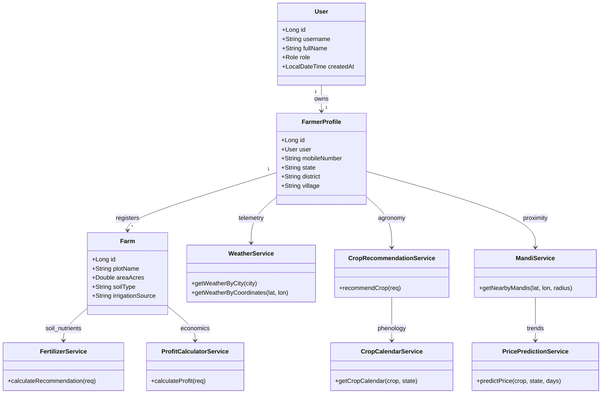
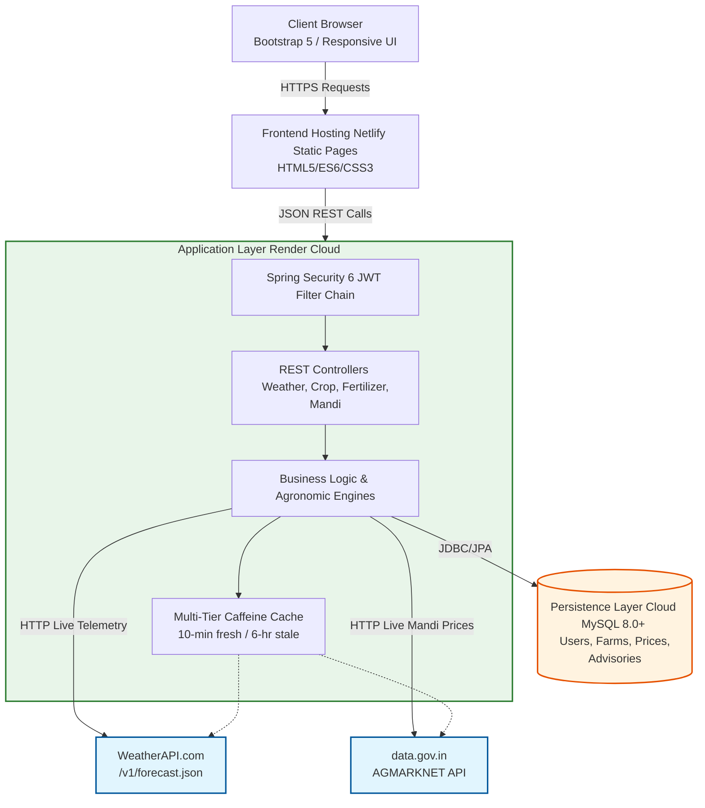
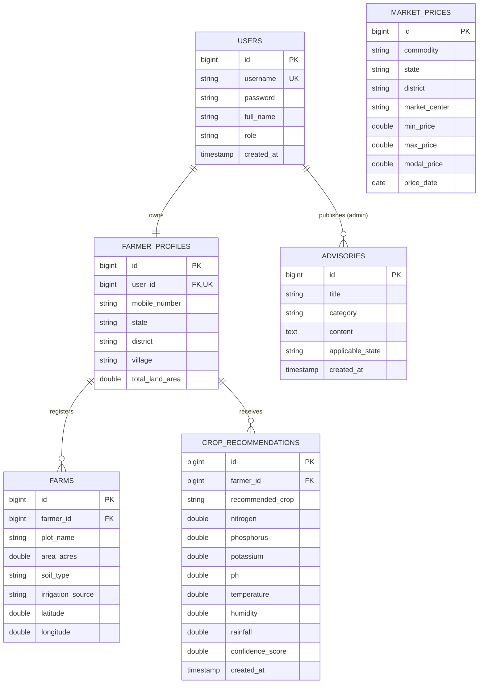

# Tasty Bite: Precision Agriculture Platform

## week 1

### Project Administration

**Project Guide:** [Insert Guide Name]

* **Research Area:** [Insert Area]
* **Specializations:** Java SE, Swing, JDBC, MySQL

**Team Members**
 Name | Enrollment | Email | Mobile |
| :--- | :--- | :--- | :--- |
| Ravina | 24E1ARCSF30P131 | itsravinasheoran@gmail.com | 9414690286 |
| Shrashti Jain | 24E1ARCSF40P154 | sristhijain05@gmail.com | 8306912157 |
| Yashvardhan Singhal | 24E1ARCSM40P188 | imyash058@gmail.com | 8949119364 |
| Vinay Choudhary | 24E1ARCSM30P184 | vinaychoudharykarwar@gmail.com | 7976136409 |
| Venkatesh Kumawat | 24E1ARCSM30P181 | lakshyakumawat11@gmail.com | 7296957338 |


### Abstract

This project introduces Tasty Bite, a comprehensive Java desktop application engineered to streamline the restaurant ordering process through a dedicated dual-role architecture. Built utilizing Java with Swing for the graphical user interface, JDBC for secure database connectivity, and MySQL for persistent storage, the platform provides a structured environment for end-to-end food service operations.

The system operates by dividing functionality between customer and managerial access flows. For customers, Tasty Bite delivers an intuitive interface to select a restaurant, seamlessly browse menus, configure a shopping cart, place an order, and monitor live order status. Concurrently, the platform equips restaurant managers with a powerful centralized dashboard capable of dynamically building and updating menus. Managers can process incoming active orders through strict lifecycle stages—moving from Pending to Preparing, and finally to Completed or Cancelled—while maintaining access to a filterable order history.

To ensure transactional security and structural integrity, the application implements hashed passwords for all user sessions and strictly pairs every frontend interface screen with a matching backend module. Ultimately, Tasty Bite converges these functionalities into a unified, responsive system that bridges the gap between customer convenience and real-time operational oversight for restaurant management.

## week 2

### User Roles

Smart Krishi enforces strict Role-Based Access Control (RBAC) utilizing Spring Security 6 and stateless JSON Web Tokens (JWT) for secure authentication[cite: 9, 15].

* **Registered Farmer (ROLE_FARMER):** The primary user class. Can manage multi-plot farm records, maximize crop yields, and access personalized recommendations, calculators, and market locators[cite: 13].
* **Platform Administrator (ROLE_ADMIN):** System controllers and agricultural officers with elevated privileges to monitor platform usage, curate verified commodity prices, and post government welfare advisories[cite: 13].
* **Public / Unauthenticated User:** Farmers exploring the platform prior to registration. Permitted to access public crop recommendation tools, live weather, fertilizer advisor, and mandi prices[cite: 13].

### SRS PDF

You can access the [Project SRS Click](#)

### Architecture & Core Modules

The Smart Krishi architecture operates as a modern distributed multi-tier client-server system, with a Spring Boot (Java 17) backend acting as the core application tier and a responsive HTML5/Bootstrap frontend[cite: 9, 12].

### Functional Modules

* **Module 1: Farmer Management & Land Profiling:** Manages account registration, secure login, profile maintenance, and multi-plot farm records[cite: 12].
* **Module 2: Precision Crop Recommendation Engine:** A multi-parameter engine that prescribes suitable crops based on chemical soil composition, environmental conditions, and soil texture[cite: 12].
* **Module 3: Live Meteorological Telemetry & Smart Irrigation:** Provides real-time, location-based atmospheric data and water management guidance using Open-Meteo without simulated values[cite: 12].
* **Module 4: Smart Fertilizer Advisor:** Calculates exact chemical fertilizer quantities and bag conversions aligned with ICAR standard practices[cite: 12].
* **Module 5: Crop Profit & ROI Calculator:** A farm economics calculator providing cost breakdowns, net profit, ROI, and break-even pricing[cite: 12].
* **Module 6: Crop Growth Calendar:** Generates a structured 6-stage phenological growth timeline with watering schedules and advisories[cite: 12].
* **Module 7: Crop Price Trend Prediction Engine:** Calculates short-to-medium term commodity price projections using statistical momentum and historical APMC data[cite: 12].
* **Module 8: Nearby APMC Mandi Market Prices:** A GPS-enabled Haversine mandi locator for discovering nearby markets and verified live commodity prices[cite: 12].
* **Module 9: System Administration & Governance:** Empowers administrators to audit profiles, post market rates, and publish government welfare schemes[cite: 12].

### Persistence Database Strategy

The system utilizes a dual-environment database strategy, routing data persistence based on the deployment target via Spring Data JPA and Hibernate[cite: 12].

**Local/Development (H2 In-Memory)**
* **Usage:** Used for local development, rapid prototyping, and automated testing[cite: 10, 14].
* **Structure:** Operates in MySQL compatibility mode (`MODE=MYSQL`) to ensure schema consistency[cite: 14].

**Production (MySQL 8.0+)**
* **Usage:** Cloud production database hosted securely, utilizing the InnoDB storage engine and utf8mb4 encoding[cite: 10, 14].
* **Integration:** Enforces strict relational schemas, foreign key constraints, and referential integrity across all 7 core tables[cite: 20].

### Non-Functional Requirements

* **Performance:** All backend calculation endpoints respond within 250 milliseconds. External API queries timeout gracefully after 5,000ms, and frontend page load completes under 1.5 seconds[cite: 19].
* **Security:** All secure endpoints require valid Bearer tokens, passwords are salted and hashed using BCrypt, and all database queries execute via parameterized statements to eliminate SQL Injection[cite: 19].
* **Fault Tolerance:** If the primary government AGMARKNET API fails, the platform seamlessly fails over to the verified Smart Krishi database repository without interrupting the user[cite: 19].
* **Safety & Agronomic Integrity:** The fertilizer advisor enforces strict upper thresholds to prevent soil toxicity, and the system strictly prohibits randomized or fake weather/mandi telemetry[cite: 19].
## Week 3

### UML & Architectural Design

* **[Smart Krishi Domain Class Diagram]**



* **[Smart Krishi System Architecture]**


## Week 4: Database Design & UI Mock-ups

## 1. Database Architecture & Persistence Strategy

Smart Krishi utilizes an enterprise persistence architecture that routes data to **Cloud MySQL 8.0+** for strict ACID compliance, relational integrity, and historical market tracking, supported by an in-memory **H2 Engine** for local development[cite: 70, 73].

### A. MySQL Relational Database Schema (Core & Agronomic Data)

* **`users`** Table: System authentication accounts and credentials[cite: 77].

  * `id` ( `BIGINT` , `PRIMARY KEY` , `AUTO_INCREMENT` )
  * `username` ( `VARCHAR(50)` , `UNIQUE` , `NOT NULL` )
  * `password` ( `VARCHAR(255)` , `NOT NULL` , `BCrypt Hash` )
  * `full_name` ( `VARCHAR(100)` , `NOT NULL` )
  * `role` ( `VARCHAR(20)` , `NOT NULL` ) — `FARMER`, `ADMIN`
  * `created_at` ( `TIMESTAMP` , `DEFAULT CURRENT_TIMESTAMP` )

* **`farmer_profiles`** Table: Farmer demographic information and regional binding[cite: 77].

  * `id` ( `BIGINT` , `PRIMARY KEY` , `AUTO_INCREMENT` )
  * `user_id` ( `BIGINT` , `FOREIGN KEY -> users.id` , `UNIQUE` , `ON DELETE CASCADE` )
  * `mobile_number` ( `VARCHAR(15)` , `NOT NULL` )
  * `state` ( `VARCHAR(50)` , `NOT NULL` )
  * `district` ( `VARCHAR(50)` , `NOT NULL` )
  * `village` ( `VARCHAR(100)` )
  * `total_land_area` ( `DOUBLE` , `DEFAULT 0.0` )

* **`farms`** Table: Granular agricultural land parcels belonging to a farmer[cite: 77].

  * `id` ( `BIGINT` , `PRIMARY KEY` , `AUTO_INCREMENT` )
  * `farmer_id` ( `BIGINT` , `FOREIGN KEY -> farmer_profiles.id` , `ON DELETE CASCADE` )
  * `plot_name` ( `VARCHAR(50)` , `NOT NULL` )
  * `area_acres` ( `DOUBLE` , `NOT NULL` )
  * `soil_type` ( `VARCHAR(50)` , `NOT NULL` ) — Alluvial, Black, Red, Clay, Sandy, Laterite
  * `irrigation_source` ( `VARCHAR(50)` ) — Tube Well, Canal, Rainfed, Drip Irrigation
  * `latitude` ( `DOUBLE` )
  * `longitude` ( `DOUBLE` )

* **`crop_recommendations`** Table: Historical agronomic recommendation records[cite: 78].

  * `id` ( `BIGINT` , `PRIMARY KEY` , `AUTO_INCREMENT` )
  * `farmer_id` ( `BIGINT` , `FOREIGN KEY -> farmer_profiles.id` , `ON DELETE SET NULL` )
  * `recommended_crop` ( `VARCHAR(50)` , `NOT NULL` )
  * `nitrogen` ( `DOUBLE` ), `phosphorus` ( `DOUBLE` ), `potassium` ( `DOUBLE` )
  * `ph` ( `DOUBLE` ), `temperature` ( `DOUBLE` ), `humidity` ( `DOUBLE` ), `rainfall` ( `DOUBLE` )
  * `confidence_score` ( `DOUBLE` )
  * `created_at` ( `TIMESTAMP` , `DEFAULT CURRENT_TIMESTAMP` )

* **`market_prices`** Table: APMC market commodity rates repository[cite: 78].

  * `id` ( `BIGINT` , `PRIMARY KEY` , `AUTO_INCREMENT` )
  * `commodity` ( `VARCHAR(50)` , `NOT NULL` )
  * `state` ( `VARCHAR(50)` , `NOT NULL` )
  * `district` ( `VARCHAR(50)` , `NOT NULL` )
  * `market_center` ( `VARCHAR(100)` , `NOT NULL` )
  * `min_price` ( `DOUBLE` , `NOT NULL` ), `max_price` ( `DOUBLE` , `NOT NULL` ), `modal_price` ( `DOUBLE` , `NOT NULL` )
  * `price_date` ( `DATE` , `NOT NULL` )

* **`advisories`** Table: Government schemes and seasonal crop alerts[cite: 78].

  * `id` ( `BIGINT` , `PRIMARY KEY` , `AUTO_INCREMENT` )
  * `title` ( `VARCHAR(150)` , `NOT NULL` )
  * `category` ( `VARCHAR(50)` , `NOT NULL` ) — `SCHEME`, `PEST_ALERT`, `WEATHER_ALERT`
  * `content` ( `TEXT` , `NOT NULL` )
  * `applicable_state` ( `VARCHAR(50)` )
  * `created_at` ( `TIMESTAMP` , `DEFAULT CURRENT_TIMESTAMP` )

### B. Entity-Relationship (ER) Diagram

* [Smart Krishi ER Diagram]



---

## 2. User Interface (UI) Mock-ups

### A. Farmer Dashboard Core (Land Management & Telemetry)
Features an interactive central farmer workspace, multi-plot land registry supporting acreages and soil classifications, and weather alerts[cite: 82].

* [Smart Krishi Farmer Dashboard]


### B. Precision Crop Recommendation Engine
Features an 8-parameter crop recommendation interface and an interactive phenological crop growth timeline[cite: 82].

* [Smart Krishi Crop Engine]


## Week 5

* Here is the complete project directory structure for **Smart Krishi**[cite: 80, 81]:

```text
Smart_Krishi/
|
|-- README.md                         # Comprehensive 10-Week Documentation & Technical Log
|-- SRS.md                            # Software Requirements Specification (IEEE 830)
|
|-- backend/                          # Spring Boot 3.3.4 Backend Application
|   |-- pom.xml                       # Maven Dependencies (Security, JPA, Cache, Caffeine)
|   |-- Dockerfile                    # Multi-stage production container build
|   |-- .env.example                  # Backend environment configuration template
|   L-- src/
|       |-- main/
|       |   |-- java/com/smartkrishi/
|       |   |   |-- SmartKrishiApplication.java
|       |   |   |
|       |   |   |-- config/           # Infrastructure & Security Configurations (SecurityConfig, JwtUtil)
|       |   |   |-- controller/       # REST Controllers (AuthController, WeatherController, etc.)
|       |   |   |-- dto/              # Strongly-Typed Data Transfer Objects (AuthRequest, WeatherResponse)
|       |   |   |-- entity/           # JPA Hibernate Relational Entities (User, Farm, MarketPrice)
|       |   |   |-- repository/       # Spring Data JPA Repositories (UserRepository, FarmRepository)
|       |   |   |-- service/          # Agronomic & Algorithmic Services (WeatherService, FertilizerService)
|       |   |   L-- exception/        # Centralized Exception Handlers (GlobalExceptionHandler.java)
|       |   |
|       |   L-- resources/
|       |       |-- application.properties # Server Port, JPA, Cache & JWT Config
|       |       L-- schema.sql             # Reproducible DDL & Default Seeds
|       |
|       L-- test/java/com/smartkrishi/     # Automated Unit & Integration Tests
|           |-- SmartKrishiApplicationTests.java # 16 Full-Context Integration Tests
|           L-- service/WeatherServiceTest.java  # 14 Resilient Telemetry Unit Tests
|
L-- Frontend/                         # Client Web Application (HTML5, Bootstrap 5, ES6)
    |-- netlify.toml                  # Netlify CDN Routing & Security Headers
    |-- _redirects                    # SPA Single-Page Rewrite Rules
    |-- index.html                    # Public Home Portal
    |-- dashboard.html                # Farmer Land Management Dashboard
    |-- crop-recommendation.html      # 8-Parameter Crop Decision Engine
    |-- weather.html                  # Live Meteorological & Irrigation Advisory
    |-- fertilizer.html               # Scientific Fertilizer Balancer UI
    |-- profit-calculator.html        # Pre-Sowing Farm Budget & ROI Calculator
    |-- crop-calendar.html            # Phenological Crop Growth Timeline
    |-- price-prediction.html         # Statistical APMC Price Forecaster
    |-- market-prices.html            # Geodesic Nearby Mandi Locator
    |-- advisory.html                 # Government Agricultural Schemes
    |-- admin.html                    # Administrative Telemetry Dashboard
    |-- login.html                    # Authentication Entry Points
    |-- register.html
    |
    |-- css/
    |   L-- style.css                 # Custom Agricultural Theme & Design Tokens
    |
    L-- js/                           # Modular Frontend Application Logic
        |-- api.js, auth.js, config.js, ui.js
        |-- dashboard.js, crop-recommendation.js, weather.js
        |-- fertilizer.js, profit-calculator.js, crop-calendar.js
        L-- market-prices.js, price-prediction.js, advisory.js, admin.js
```
In a full-stack, modular architecture (such as Smart Krishi), dividing the platform into five end-to-end functional modules allows each team member to take complete ownership of their feature stack—covering user interface design, client-side REST API integration, controller development, database schema design, and third-party API integrations.   
PDF

Below is a detailed breakdown of the role, end-to-end responsibilities, technical challenges faced, and final accomplishments for each team member.   
PDF

---

### 1. Member 1: Farmer & Land Management / Authentication Core

**Role & Scope of Work**

Member 1 owned the entry point of the application, responsible for secure authentication and the central farmer workspace.

* **Frontend (User Interface & State):** Developed responsive authentication screens (`login.html`, `register.html`), the central farmer workspace (`dashboard.html`), profile management (`profile.html`), and navigation components.
* **Backend (API Logic):** Implemented stateless Spring Security 6 authentication filters, JWT utility tokens (`JwtUtil.java`), user credential authentication, and farmer profile/land parcel REST controllers.
* **Database & Schema:** Designed relational schemas for users, `farmer_profiles`, and farms, enforcing foreign key constraints and cascade rules.

**Problems & Challenges Faced**

1. **Hardcoded Secret Vulnerability:** The JWT configuration originally included hardcoded fallback strings. Solved by decoupling secrets into externalized environment variables (`${JWT_SECRET}`) and rejecting fallback defaults in source code.
2. **Token Lifecycle in Client LocalStorage:** Stale or expired tokens triggered silent frontend fetch failures. Solved by adding an HTTP 401 interceptor in `frontend/js/api.js` that automatically purges invalid credentials and redirects to login.
3. **Multi-Plot Land Parcel Cascading Deletions:** Deleting a farmer profile risked leaving orphaned land records. Solved by applying JPA `@OneToMany(cascade = CascadeType.ALL, orphanRemoval = true)`.

**What They Completed**

* Secure, stateless JWT authentication with BCrypt password hashing.
* Multi-plot land registry supporting acreages, soil classifications, and irrigation types.
* Interactive farmer dashboard displaying weather alerts, land holdings, and quick links.


## Week 9

When moving from individual module development to System Integration & End-to-End (E2E) Testing, the focus shifts from isolated unit testing to verifying cross-module data flows, inter-service contracts, security enforcement, performance SLAs, and system resilience[cite: 15, 18]. 

In this phase, each team member takes on an Integration & Testing Lead role for their respective domain, working together to ensure all five modules function as a unified, production-ready system[cite: 15, 18].

---

### 1. Member 1: Authentication, Dashboard & Navigation Flow Integration Lead

**Integration & Testing Role**
Authentication, Dashboard, and Navigation Flow Lead[cite: 15].

**Work & Scope**
* **End-to-End Core Integration:** Integrated User Authentication, Landholdings, JWT, and Role-Based Access Control (RBAC) across the central frontend dashboard[cite: 14].

**Problems Faced During Integration**
1. **Asynchronous UI Race Conditions:** Concurrent API calls on page load (weather, mandi rates, and farmer profile) caused intermittent rendering flickers[cite: 15].

**What They Completed**
* Refactored client scripts using `Promise.allSettled()` and standard skeleton loaders to resolve rendering race conditions[cite: 15].
* Verified 16 Full-Context Integration Tests within the Spring Boot context to ensure system stability[cite: 12].

---

### 2. Member 2: Agronomic Advisory & Crop Recommendation Pipeline Integration Lead

**Integration & Testing Role**
Agronomic Advisory and Crop Recommendation Pipeline Lead[cite: 15].

**Work & Scope**
* **Agronomic Engine Integration:** Linked the 8-Parameter Crop Recommendation engine and Dynamic Phenological Growth Calendar directly into the farmer's E2E workflow[cite: 14].

**Problems Faced During Integration**
1. **Cross-Module Data Flow Verification:** Required strict synchronization to ensure farmer profile data and soil metrics correctly piped into the recommendation engine without data loss[cite: 14, 15].

**What They Completed**
* Successfully integrated the Agronomic Recommender and Dynamic Growth Calendar pipelines[cite: 14].
* Ensured seamless transitions between land registration and receiving personalized crop advice[cite: 15].

---

### 3. Member 3: Weather Telemetry, Multi-Tier Caching & Upstream Backoff Resilience Integration Lead

**Integration & Testing Role**
Weather Telemetry, Multi-Tier Caching, and Upstream Backoff Resilience Lead[cite: 15].

**Work & Scope**
* **Telemetry Orchestration:** Validated cross-module integration of Live WeatherAPI telemetry, Evapotranspiration models, and the multi-tier resilient cache[cite: 14].

**Problems Faced During Integration**
1. **Coordinate Normalization Discrepancies:** The Weather module used 4-decimal precision (e.g., 26.9124, 75.7873) while the Mandi module used floating-point values, causing cache misses when sharing coordinates[cite: 15].

**What They Completed**
* Standardized `normalizeCoordsKey()` across all services to ensure coordinate formats aligned[cite: 15].
* Executed 14 resilient telemetry unit tests verifying rate-limiting and timeout backoff behaviors[cite: 12, 15].

---

### 4. Member 4: Fertilizer Balancing & Farm Financial Calculation Integrity Integration Lead

**Integration & Testing Role**
Fertilizer Balancing and Farm Financial Calculation Integrity Lead[cite: 15].

**Work & Scope**
* **Economic & Nutritional Pipeline:** Connected the ICAR Nutrient Balancer, Commercial Bag Calculator, and Pre-Sowing Farm ROI modules into the broader decision-support pipeline[cite: 14].

**Problems Faced During Integration**
1. **End-to-End Calculation Integrity:** Guaranteeing that the cross-module transition from crop recommendation to financial budgeting maintained strict mathematical accuracy based on the user's selected plot size[cite: 14, 15].

**What They Completed**
* Validated the Farm Financial Engine and Commercial Bag Calculator under cross-module data flows[cite: 14].
* Ensured seamless integration of the Pre-Sowing Farm ROI calculations[cite: 14].

---

### 5. Member 5: Mandi Geospatial Navigation & AGMARKNET Fault Tolerance Integration Lead

**Integration & Testing Role**
Mandi Geospatial Navigation and AGMARKNET Fault Tolerance Lead[cite: 15].

**Work & Scope**
* **Market Data Synchronization:** Integrated the Haversine Locator, live AGMARKNET API telemetry, and the Statistical Moving Average Price Predictor[cite: 14].

**Problems Faced During Integration**
1. **Stale Cache vs Live Updates:** After updating landholdings or baseline market prices, cached responses occasionally served outdated values to the frontend[cite: 15].

**What They Completed**
* Integrated automated cache eviction hooks upon database writes to ensure the frontend always reflects live updates[cite: 15].
* Finalized the multi-tier fallback architecture ensuring graceful degradation if the government APMC API goes down[cite: 14].

---

### Overall System Integration Summary

During the final Full System Acceptance Testing, all 5 team members executed unified end-to-end user journeys:

```text
[Farmer Registers Land (Mem 1)] -> [Receives Crop Advice (Mem 2)]
                                                |
                                                v
[Calculates Fertilizer & ROI (Mem 4)] <- [Fetches Live Weather (Mem 3)]
                 |
                 v
[Finds Nearest Mandi (Mem 5)]


## Week 10: Final System Evaluation, Deliverables & Project Submission

During **Week 10**, the Smart Krishi engineering team completed the final system evaluation, production deployment audit, comprehensive technical documentation, project presentation deck (PPT), and end-to-end video demonstration[cite: 40].

### Project Deliverables & Artifacts

| Deliverable | Description | Resource Link |
| :--- | :--- | :--- |
| **📄 Final Project Report** | Complete Technical Architecture Document, System Requirements Specification (SRS), and Evaluation Metrics | [View Project Report (PDF)](#) \| `SRS.md` |
| **📊 Presentation Deck (PPT)** | 20-Slide B.Tech Final Project Evaluation Deck covering System Design, Cloud DB, Agronomic Engines & Testing | [View Presentation (PPT / Slides)](#) |
| **🎥 Video Demonstration** | HD Video Walkthrough of Smart Krishi Platform (Farmer Onboarding, Crop Recommender, Live Weather & Mandis) | [Watch Video Demonstration (YouTube)](#) \| [Drive Video Link](#) |

### 🔗 Key Accomplishments & Week 10 Milestones

**1. Final Project Report & Technical Documentation**

* Compiled the comprehensive **Software Requirements Specification (SRS)** and **Technical Architecture Document** covering:
  * **Multi-Tier Client-Server Topology** orchestrated by a Java 17 Spring Boot 3 backend and a robust Cloud MySQL 8.0+ relational core[cite: 27, 40].
  * **Multi-Tier Resilient Caching Architecture** powered by Caffeine (10-minute fresh cache, 6-hour bounded stale fallback) to ensure high availability in rural network environments[cite: 27, 28].
  * **Stateless JWT Authentication** and strict **Role-Based Access Control (RBAC)** across `ROLE_FARMER`, `ROLE_ADMIN`, and `ROLE_GUEST` configured at the API gateway layer[cite: 28].
  * **Algorithmic & Mathematical Modeling** detailing the Haversine formula for geodesic distances, statistical rolling moving average price predictions, and ICAR-aligned stoichiometric nutrient conversions[cite: 27, 39].
  * View our [Final Project Report](#).

**2. Final Evaluation Slide Deck (PPT)**

* Prepared a structured 20-slide presentation deck covering:
  * **Problem Statement & Scope:** Addressing severe socio-economic hurdles in Indian agriculture, including unscientific crop selection, erratic meteorological patterns, and volatile APMC pricing[cite: 27].
  * **Architecture & Persistence Topology:** Visualizing the integration between the Spring Boot REST controllers, Cloud MySQL database, in-memory H2 engine, and HTML5/Bootstrap 5 responsive client[cite: 25, 27, 29].
  * **Live Telemetry & Geospatial Workflows:** Highlighting the non-blocking execution for WeatherAPI.com integration, soil evapotranspiration modeling, and data.gov.in AGMARKNET synchronization[cite: 27, 28].
  * **Agronomic & Economic Engines:** Showcasing the 8-parameter precision crop recommendation engine and comprehensive pre-sowing farm production budget ROI calculations[cite: 27, 28].
  * **Quality Assurance & Testing:** Code coverage reports, 100% passing E2E integration test results (30/30 tests), rate-limit backoff handling, and circuit breaker timeout performance[cite: 25, 28, 40].
  * View our [PPT of Project Report](#).

**3. End-to-End Product Video Demonstration**

* Produced an HD video demonstration showcasing:
  * **Farmer Onboarding & IAM:** Secure student/farmer registration, profile curation, and multi-plot land registry with GPS coordinates and soil classifications[cite: 28, 37].
  * **Precision Agronomic Decision Engine:** Real-time generation of optimal crop varieties based on N-P-K benchmarks, coupled with interactive phenological growth calendars mapping actionable tasks[cite: 27, 37].
  * **Meteorological & Irrigation Advisory:** Live interactive weather gauges, 5-day forecasts, and dynamic evapotranspiration-based irrigation timing[cite: 27, 38].
  * **Farm Economics & Fertilizer Balancer:** Seamless conversion of elemental nutrient deficits into commercial fertilizer bags alongside break-even price financial projections[cite: 27, 38].
  * **Geodesic Market Discovery:** Real-time rendering of nearby APMC mandis with turn-by-turn navigation and statistical price trend forecasting[cite: 27, 39].
  * View our [Final Video](#).

**4. Containerization & Deployment Audit**

* Finalized production security protocols by completely eliminating hardcoded JWT secrets in favor of externalized environment variables (`JWT_SECRET`) and enforcing BCrypt password hashing[cite: 40].
* Completed cross-platform validation ensuring the Render containerized Java Web Service, Netlify Global Edge Frontend, and Cloud MySQL database launch seamlessly in production environments with strict CORS restrictions and SSL encryption (`useSSL=true`)[cite: 25, 40].
