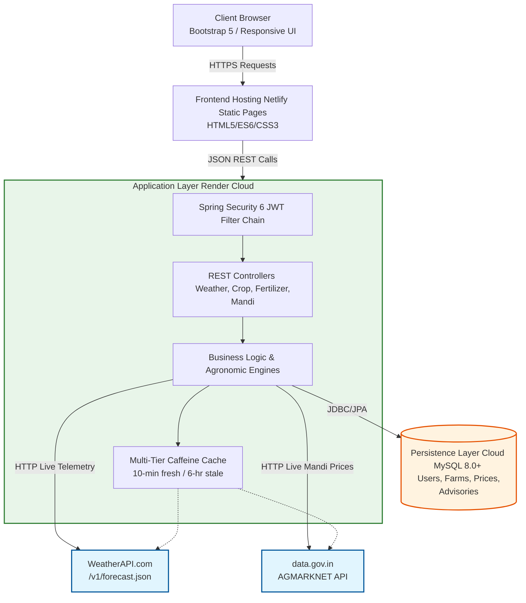
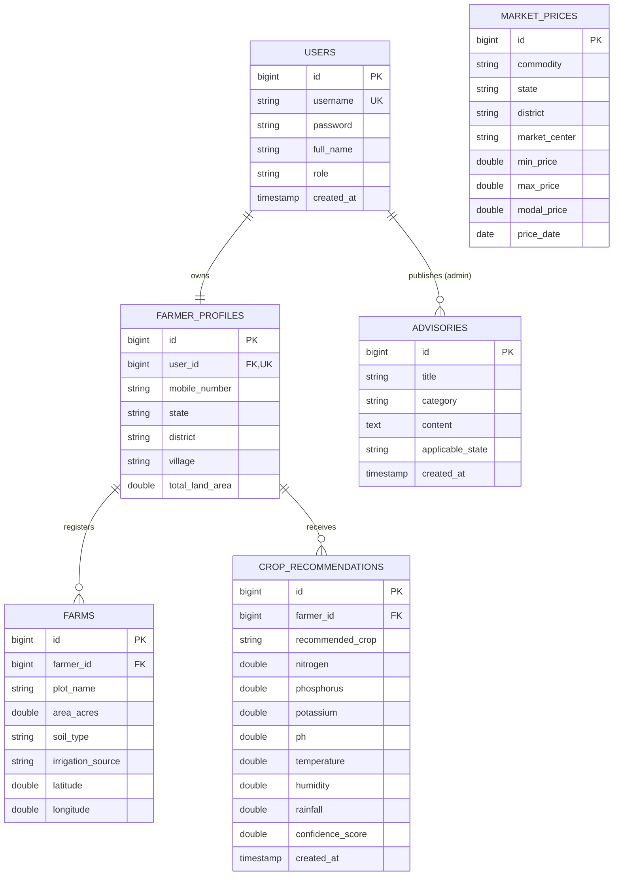

# Tasty Bite: Precision Agriculture Platform
---
## week 1

### Project Administration

**Project Guide:** [Er. Ram Babu Buri (Assistant Professor)]

* **Research Area:** [Precision Agriculture and AI-Based Smart Farming]
* **Specializations:** Java SE, Swing, JDBC, MySQL

**Team Members**
 Name | Enrollment | Email | Mobile |
| :--- | :--- | :--- | :--- |
| Ravina | 24E1ARCSF30P131 | itsravinasheoran@gmail.com | 9414690286 |
| Shrashti Jain | 24E1ARCSF40P154 | sristhijain05@gmail.com | 8306912157 |
| Yashvardhan Singhal | 24E1ARCSM40P188 | imyash058@gmail.com | 8949119364 |
| Vinay Choudhary | 24E1ARCSM30P184 | vinaychoudharykarwar@gmail.com | 7976136409 |
| Venkatesh Kumawat | 24E1ARCSM30P181 | lakshyakumawat11@gmail.com | 7296957338 |


### Abstract

This project introduces Tasty Bite, a comprehensive Java desktop application engineered to streamline the restaurant ordering process through a dedicated dual-role architecture. Built utilizing Java with Swing for the graphical user interface, JDBC for secure database connectivity, and MySQL for persistent storage, the platform provides a structured environment for end-to-end food service operations.

The system operates by dividing functionality between customer and managerial access flows. For customers, Tasty Bite delivers an intuitive interface to select a restaurant, seamlessly browse menus, configure a shopping cart, place an order, and monitor live order status. Concurrently, the platform equips restaurant managers with a powerful centralized dashboard capable of dynamically building and updating menus. Managers can process incoming active orders through strict lifecycle stages—moving from Pending to Preparing, and finally to Completed or Cancelled—while maintaining access to a filterable order history.

To ensure transactional security and structural integrity, the application implements hashed passwords for all user sessions and strictly pairs every frontend interface screen with a matching backend module. Ultimately, Tasty Bite converges these functionalities into a unified, responsive system that bridges the gap between customer convenience and real-time operational oversight for restaurant management.
---
## week 2

### User Roles

Smart Krishi enforces strict Role-Based Access Control (RBAC) utilizing Spring Security 6 and stateless JSON Web Tokens (JWT) for secure authentication[cite: 9, 15].

* **Registered Farmer (ROLE_FARMER):** The primary user class. Can manage multi-plot farm records, maximize crop yields, and access personalized recommendations, calculators, and market locators[cite: 13].
* **Platform Administrator (ROLE_ADMIN):** System controllers and agricultural officers with elevated privileges to monitor platform usage, curate verified commodity prices, and post government welfare advisories[cite: 13].
* **Public / Unauthenticated User:** Farmers exploring the platform prior to registration. Permitted to access public crop recommendation tools, live weather, fertilizer advisor, and mandi prices[cite: 13].

### SRS PDF

You can access the [Project SRS Click](#)

### Architecture & Core Modules

The Smart Krishi architecture operates as a modern distributed multi-tier client-server system, with a Spring Boot (Java 17) backend acting as the core application tier and a responsive HTML5/Bootstrap frontend[cite: 9, 12].

### Functional Modules

* **Module 1: Farmer Management & Land Profiling:** Manages account registration, secure login, profile maintenance, and multi-plot farm records[cite: 12].
* **Module 2: Precision Crop Recommendation Engine:** A multi-parameter engine that prescribes suitable crops based on chemical soil composition, environmental conditions, and soil texture[cite: 12].
* **Module 3: Live Meteorological Telemetry & Smart Irrigation:** Provides real-time, location-based atmospheric data and water management guidance using Open-Meteo without simulated values[cite: 12].
* **Module 4: Smart Fertilizer Advisor:** Calculates exact chemical fertilizer quantities and bag conversions aligned with ICAR standard practices[cite: 12].
* **Module 5: Crop Profit & ROI Calculator:** A farm economics calculator providing cost breakdowns, net profit, ROI, and break-even pricing[cite: 12].
* **Module 6: Crop Growth Calendar:** Generates a structured 6-stage phenological growth timeline with watering schedules and advisories[cite: 12].
* **Module 7: Crop Price Trend Prediction Engine:** Calculates short-to-medium term commodity price projections using statistical momentum and historical APMC data[cite: 12].
* **Module 8: Nearby APMC Mandi Market Prices:** A GPS-enabled Haversine mandi locator for discovering nearby markets and verified live commodity prices[cite: 12].
* **Module 9: System Administration & Governance:** Empowers administrators to audit profiles, post market rates, and publish government welfare schemes[cite: 12].

### Persistence Database Strategy

The system utilizes a dual-environment database strategy, routing data persistence based on the deployment target via Spring Data JPA and Hibernate[cite: 12].

**Local/Development (H2 In-Memory)**
* **Usage:** Used for local development, rapid prototyping, and automated testing[cite: 10, 14].
* **Structure:** Operates in MySQL compatibility mode (`MODE=MYSQL`) to ensure schema consistency[cite: 14].

**Production (MySQL 8.0+)**
* **Usage:** Cloud production database hosted securely, utilizing the InnoDB storage engine and utf8mb4 encoding[cite: 10, 14].
* **Integration:** Enforces strict relational schemas, foreign key constraints, and referential integrity across all 7 core tables[cite: 20].

### Non-Functional Requirements

* **Performance:** All backend calculation endpoints respond within 250 milliseconds. External API queries timeout gracefully after 5,000ms, and frontend page load completes under 1.5 seconds[cite: 19].
* **Security:** All secure endpoints require valid Bearer tokens, passwords are salted and hashed using BCrypt, and all database queries execute via parameterized statements to eliminate SQL Injection[cite: 19].
* **Fault Tolerance:** If the primary government AGMARKNET API fails, the platform seamlessly fails over to the verified Smart Krishi database repository without interrupting the user[cite: 19].
* **Safety & Agronomic Integrity:** The fertilizer advisor enforces strict upper thresholds to prevent soil toxicity, and the system strictly prohibits randomized or fake weather/mandi telemetry[cite: 19].
---
## Week 3

### UML & Architectural Design

* **[Smart Krishi Domain Class Diagram]**


* **[Smart Krishi System Architecture]**


---
## Week 4: Database Design & UI Mock-ups

## 1. Database Architecture & Persistence Strategy

Smart Krishi utilizes an enterprise persistence architecture that routes data to **Cloud MySQL 8.0+** for strict ACID compliance, relational integrity, and historical market tracking, supported by an in-memory **H2 Engine** for local development[cite: 70, 73].

### A. MySQL Relational Database Schema (Core & Agronomic Data)

* **`users`** Table: System authentication accounts and credentials[cite: 77].

  * `id` ( `BIGINT` , `PRIMARY KEY` , `AUTO_INCREMENT` )
  * `username` ( `VARCHAR(50)` , `UNIQUE` , `NOT NULL` )
  * `password` ( `VARCHAR(255)` , `NOT NULL` , `BCrypt Hash` )
  * `full_name` ( `VARCHAR(100)` , `NOT NULL` )
  * `role` ( `VARCHAR(20)` , `NOT NULL` ) — `FARMER`, `ADMIN`
  * `created_at` ( `TIMESTAMP` , `DEFAULT CURRENT_TIMESTAMP` )

* **`farmer_profiles`** Table: Farmer demographic information and regional binding[cite: 77].

  * `id` ( `BIGINT` , `PRIMARY KEY` , `AUTO_INCREMENT` )
  * `user_id` ( `BIGINT` , `FOREIGN KEY -> users.id` , `UNIQUE` , `ON DELETE CASCADE` )
  * `mobile_number` ( `VARCHAR(15)` , `NOT NULL` )
  * `state` ( `VARCHAR(50)` , `NOT NULL` )
  * `district` ( `VARCHAR(50)` , `NOT NULL` )
  * `village` ( `VARCHAR(100)` )
  * `total_land_area` ( `DOUBLE` , `DEFAULT 0.0` )

* **`farms`** Table: Granular agricultural land parcels belonging to a farmer[cite: 77].

  * `id` ( `BIGINT` , `PRIMARY KEY` , `AUTO_INCREMENT` )
  * `farmer_id` ( `BIGINT` , `FOREIGN KEY -> farmer_profiles.id` , `ON DELETE CASCADE` )
  * `plot_name` ( `VARCHAR(50)` , `NOT NULL` )
  * `area_acres` ( `DOUBLE` , `NOT NULL` )
  * `soil_type` ( `VARCHAR(50)` , `NOT NULL` ) — Alluvial, Black, Red, Clay, Sandy, Laterite
  * `irrigation_source` ( `VARCHAR(50)` ) — Tube Well, Canal, Rainfed, Drip Irrigation
  * `latitude` ( `DOUBLE` )
  * `longitude` ( `DOUBLE` )

* **`crop_recommendations`** Table: Historical agronomic recommendation records[cite: 78].

  * `id` ( `BIGINT` , `PRIMARY KEY` , `AUTO_INCREMENT` )
  * `farmer_id` ( `BIGINT` , `FOREIGN KEY -> farmer_profiles.id` , `ON DELETE SET NULL` )
  * `recommended_crop` ( `VARCHAR(50)` , `NOT NULL` )
  * `nitrogen` ( `DOUBLE` ), `phosphorus` ( `DOUBLE` ), `potassium` ( `DOUBLE` )
  * `ph` ( `DOUBLE` ), `temperature` ( `DOUBLE` ), `humidity` ( `DOUBLE` ), `rainfall` ( `DOUBLE` )
  * `confidence_score` ( `DOUBLE` )
  * `created_at` ( `TIMESTAMP` , `DEFAULT CURRENT_TIMESTAMP` )

* **`market_prices`** Table: APMC market commodity rates repository[cite: 78].

  * `id` ( `BIGINT` , `PRIMARY KEY` , `AUTO_INCREMENT` )
  * `commodity` ( `VARCHAR(50)` , `NOT NULL` )
  * `state` ( `VARCHAR(50)` , `NOT NULL` )
  * `district` ( `VARCHAR(50)` , `NOT NULL` )
  * `market_center` ( `VARCHAR(100)` , `NOT NULL` )
  * `min_price` ( `DOUBLE` , `NOT NULL` ), `max_price` ( `DOUBLE` , `NOT NULL` ), `modal_price` ( `DOUBLE` , `NOT NULL` )
  * `price_date` ( `DATE` , `NOT NULL` )

* **`advisories`** Table: Government schemes and seasonal crop alerts[cite: 78].

  * `id` ( `BIGINT` , `PRIMARY KEY` , `AUTO_INCREMENT` )
  * `title` ( `VARCHAR(150)` , `NOT NULL` )
  * `category` ( `VARCHAR(50)` , `NOT NULL` ) — `SCHEME`, `PEST_ALERT`, `WEATHER_ALERT`
  * `content` ( `TEXT` , `NOT NULL` )
  * `applicable_state` ( `VARCHAR(50)` )
  * `created_at` ( `TIMESTAMP` , `DEFAULT CURRENT_TIMESTAMP` )

### B. Entity-Relationship (ER) Diagram

* [Smart Krishi ER Diagram]



---

## 2. User Interface (UI) Mock-ups

### A. Farmer Dashboard Core (Land Management & Telemetry)
Features an interactive central farmer workspace, multi-plot land registry supporting acreages and soil classifications, and weather alerts[cite: 82].

* [Smart Krishi Farmer Dashboard]


### B. Precision Crop Recommendation Engine
Features an 8-parameter crop recommendation interface and an interactive phenological crop growth timeline[cite: 82].

* [Smart Krishi Crop Engine]

---
## Week 5

* Here is the complete project directory structure for **Smart Krishi**[cite: 80, 81]:

```text
Smart_Krishi/
|
|-- README.md                         # Comprehensive 10-Week Documentation & Technical Log
|-- SRS.md                            # Software Requirements Specification (IEEE 830)
|
|-- backend/                          # Spring Boot 3.3.4 Backend Application
|   |-- pom.xml                       # Maven Dependencies (Security, JPA, Cache, Caffeine)
|   |-- Dockerfile                    # Multi-stage production container build
|   |-- .env.example                  # Backend environment configuration template
|   L-- src/
|       |-- main/
|       |   |-- java/com/smartkrishi/
|       |   |   |-- SmartKrishiApplication.java
|       |   |   |
|       |   |   |-- config/           # Infrastructure & Security Configurations (SecurityConfig, JwtUtil)
|       |   |   |-- controller/       # REST Controllers (AuthController, WeatherController, etc.)
|       |   |   |-- dto/              # Strongly-Typed Data Transfer Objects (AuthRequest, WeatherResponse)
|       |   |   |-- entity/           # JPA Hibernate Relational Entities (User, Farm, MarketPrice)
|       |   |   |-- repository/       # Spring Data JPA Repositories (UserRepository, FarmRepository)
|       |   |   |-- service/          # Agronomic & Algorithmic Services (WeatherService, FertilizerService)
|       |   |   L-- exception/        # Centralized Exception Handlers (GlobalExceptionHandler.java)
|       |   |
|       |   L-- resources/
|       |       |-- application.properties # Server Port, JPA, Cache & JWT Config
|       |       L-- schema.sql             # Reproducible DDL & Default Seeds
|       |
|       L-- test/java/com/smartkrishi/     # Automated Unit & Integration Tests
|           |-- SmartKrishiApplicationTests.java # 16 Full-Context Integration Tests
|           L-- service/WeatherServiceTest.java  # 14 Resilient Telemetry Unit Tests
|
L-- Frontend/                         # Client Web Application (HTML5, Bootstrap 5, ES6)
    |-- netlify.toml                  # Netlify CDN Routing & Security Headers
    |-- _redirects                    # SPA Single-Page Rewrite Rules
    |-- index.html                    # Public Home Portal
    |-- dashboard.html                # Farmer Land Management Dashboard
    |-- crop-recommendation.html      # 8-Parameter Crop Decision Engine
    |-- weather.html                  # Live Meteorological & Irrigation Advisory
    |-- fertilizer.html               # Scientific Fertilizer Balancer UI
    |-- profit-calculator.html        # Pre-Sowing Farm Budget & ROI Calculator
    |-- crop-calendar.html            # Phenological Crop Growth Timeline
    |-- price-prediction.html         # Statistical APMC Price Forecaster
    |-- market-prices.html            # Geodesic Nearby Mandi Locator
    |-- advisory.html                 # Government Agricultural Schemes
    |-- admin.html                    # Administrative Telemetry Dashboard
    |-- login.html                    # Authentication Entry Points
    |-- register.html
    |
    |-- css/
    |   L-- style.css                 # Custom Agricultural Theme & Design Tokens
    |
    L-- js/                           # Modular Frontend Application Logic
        |-- api.js, auth.js, config.js, ui.js
        |-- dashboard.js, crop-recommendation.js, weather.js
        |-- fertilizer.js, profit-calculator.js, crop-calendar.js
        L-- market-prices.js, price-prediction.js, advisory.js, admin.js
```
In a full-stack, modular architecture (such as Smart Krishi), dividing the platform into five end-to-end functional modules allows each team member to take complete ownership of their feature stack—covering user interface design, client-side REST API integration, controller development, database schema design, and third-party API integrations.   
PDF

Below is a detailed breakdown of the role, end-to-end responsibilities, technical challenges faced, and final accomplishments for each team member.   
PDF

---

### 1. Member 1: Farmer & Land Management / Authentication Core

**Role & Scope of Work**

Member 1 owned the entry point of the application, responsible for secure authentication and the central farmer workspace.

* **Frontend (User Interface & State):** Developed responsive authentication screens (`login.html`, `register.html`), the central farmer workspace (`dashboard.html`), profile management (`profile.html`), and navigation components.
* **Backend (API Logic):** Implemented stateless Spring Security 6 authentication filters, JWT utility tokens (`JwtUtil.java`), user credential authentication, and farmer profile/land parcel REST controllers.
* **Database & Schema:** Designed relational schemas for users, `farmer_profiles`, and farms, enforcing foreign key constraints and cascade rules.

**Problems & Challenges Faced**

1. **Hardcoded Secret Vulnerability:** The JWT configuration originally included hardcoded fallback strings. Solved by decoupling secrets into externalized environment variables (`${JWT_SECRET}`) and rejecting fallback defaults in source code.
2. **Token Lifecycle in Client LocalStorage:** Stale or expired tokens triggered silent frontend fetch failures. Solved by adding an HTTP 401 interceptor in `frontend/js/api.js` that automatically purges invalid credentials and redirects to login.
3. **Multi-Plot Land Parcel Cascading Deletions:** Deleting a farmer profile risked leaving orphaned land records. Solved by applying JPA `@OneToMany(cascade = CascadeType.ALL, orphanRemoval = true)`.

**What They Completed**

* Secure, stateless JWT authentication with BCrypt password hashing.
* Multi-plot land registry supporting acreages, soil classifications, and irrigation types.
* Interactive farmer dashboard displaying weather alerts, land holdings, and quick links.
---
* ## Week 6

### 1. Member 1: Farmer & Land Management / Authentication & Dashboard Core

**Role & Scope of Work**
Member 1 focused on the core identity and land management systems, providing farmers with a secure and personalized portal[cite: 51].

* **Frontend (User Interface & State):** Developed responsive authentication screens (`login.html`, `register.html`), the central farmer workspace (`dashboard.html`), profile management (`profile.html`), and navigation components[cite: 51].
* **Backend (API Logic):** Implemented stateless Spring Security 6 authentication filters, JWT utility tokens (`JwtUtil.java`), user credential authentication, and farmer profile/land parcel REST controllers (`FarmerController.java`)[cite: 51].
* **Database & Schemas:** Designed relational schemas for `users`, `farmer_profiles`, and `farms`, enforcing strict foreign key constraints and cascade rules[cite: 51].

**Problems & Challenges Faced**
1. **Hardcoded Secret Vulnerability:** The JWT configuration originally included hardcoded fallback strings[cite: 51]. Solved by decoupling secrets into externalized environment variables (`${JWT_SECRET}`) and rejecting fallback defaults in the source code[cite: 51].
2. **Token Lifecycle in Client LocalStorage:** Stale or expired tokens triggered silent frontend fetch failures[cite: 51, 52]. Solved by adding an HTTP 401 interceptor in `frontend/js/api.js` that automatically purges invalid credentials and redirects users to the login screen[cite: 52].
3. **Multi-Plot Land Parcel Cascading Deletions:** Deleting a farmer profile risked leaving orphaned land records in the database[cite: 52]. Solved by applying the JPA annotation `@OneToMany(cascade = CascadeType.ALL, orphanRemoval = true)` to ensure complete data cleanup[cite: 52].

**What They Completed**
* Secure, stateless JWT authentication system utilizing BCrypt password hashing[cite: 52].
* A multi-plot land registry supporting exact acreages, soil classifications, and irrigation types[cite: 52].
* An interactive farmer dashboard displaying weather alerts, active land holdings, and quick links[cite: 52].

---

### 2. Member 2: Precision Crop Recommendation & Phenological Crop Calendars

**Role & Scope of Work**
Member 2 built the core agronomic decision support tools, bridging the gap between raw soil data and actionable farming timelines[cite: 52].

* **Frontend (User Interface & State):** Built the 8-parameter crop recommendation interface (`crop-recommendation.html`) and the interactive crop growth calendar (`crop-calendar.html`)[cite: 52].
* **Backend (API Logic):** Implemented the complex agronomic decision engine (`CropRecommendationService.java`) and the phenological growth calendar service (`CropCalendarService.java`)[cite: 52].
* **Agronomic Modeling:** Defined specific biological growth stages (Sowing, CRI, Vegetative, Flowering, Grain Filling, Harvest) for 11 major Indian crops, including Wheat, Rice, and Cotton[cite: 52].

**Problems & Challenges Faced**
1. **Soil & Climatic Boundary Clashing:** Borderline soil test values (e.g., pH 6.4 vs 6.5) caused unstable recommendation outputs[cite: 52]. Solved by implementing weighted scoring bands across Nitrogen, Phosphorus, Potassium, and pH levels instead of rigid thresholds[cite: 52].
2. **Dynamic Calendar Date Calculation:** Static "days-after-sowing" figures were difficult for farmers to interpret practically[cite: 52]. Solved by creating an engine that accepts a farmer's specific real-world sowing date and dynamically calculates calendar date ranges for each subsequent phase[cite: 52].
3. **Unlisted Crop Fallback:** Searching for exotic or regional crops could throw null pointer exceptions[cite: 52]. Solved by implementing a generalized, balanced phenological fallback model for unrecognized crops[cite: 52].

**What They Completed**
* An 8-parameter crop recommendation engine returning primary and secondary crop choices paired with confidence scores[cite: 52].
* An interactive crop growth timeline calculating actionable tasks (e.g., Paleva, basal fertilizer, irrigation timing) based on real-world sowing dates[cite: 52].
---
* ## Week 7

### 3. Member 3: Live Meteorological Telemetry & Precision Irrigation Advisory

**Role & Scope of Work**
Member 3 was responsible for building the real-time weather integration and the evapotranspiration-based irrigation advisory system[cite: 52].

* **Frontend (User Interface & State):** Built the live weather interface (`weather.html`), interactive gauges, and the "Use My Location" GPS workflow[cite: 52].
* **Backend (API Logic):** Developed `WeatherService.java` and `WeatherCacheConfig.java` to interface directly with WeatherAPI.com's forecast endpoints[cite: 52].
* **Resilience & Caching:** Implemented a multi-tier caching architecture (Caffeine 10-min fresh, 6-hr stale fallback), rate-limit backoffs, and network timeout circuit breaking to ensure high availability[cite: 52].

**Problems & Challenges Faced**
1. **Upstream Rate Limiting (HTTP 429):** External weather providers enforce rate quotas which caused failures during high traffic[cite: 52]. Solved by parsing `Retry-After` headers, triggering bounded backoff, and serving 6-hour cached telemetry with transparent UI notices[cite: 52].
2. **Repeated Network Timeouts:** Server unresponsiveness caused cascading delays across the platform[cite: 52]. Solved by adding a consecutive timeout threshold where 2 timeouts trigger a 20-second circuit breaker[cite: 52].
3. **Structured HTTP 400 Classification:** WeatherAPI returns HTTP 400 for multiple distinct errors[cite: 52]. Solved by parsing JSON error codes, mapping invalid locations (code 1006) to `ResourceNotFoundException`, and malformed requests to `BadRequestException`[cite: 52].

**What They Completed**
* Zero-fake meteorological tracking supporting city searches and high-accuracy GPS coordinates[cite: 52].
* Live evapotranspiration-based irrigation advice (Normal, Heavy, Light, or Pause irrigation)[cite: 52].
* 14 focused unit tests verifying rate-limiting, stale fallback, and timeout backoff[cite: 52].

---

### 4. Member 4: Smart Fertilizer Recommender & Farm Profit / ROI Economics

**Role & Scope of Work**
Member 4 built the core agricultural economic engines, translating chemical soil metrics into actionable commercial farming budgets[cite: 53].

* **Frontend (User Interface & State):** Built the interactive fertilizer balancer (`fertilizer.html`) and the pre-sowing farm profit & ROI calculator (`profit-calculator.html`)[cite: 53].
* **Backend (API Logic):** Developed `FertilizerService.java` and `ProfitCalculatorService.java` to process agronomic inputs and financial parameters[cite: 53].
* **Agronomic Mathematics:** Coded ICAR soil nutrient balancing formulas and engineered stoichiometric conversions for commercial fertilizer bags[cite: 53].

**Problems & Challenges Faced**
1. **Nutrient to Commercial Fertilizer Conversion:** Soil tests report elemental N, P, and K, whereas farmers purchase mixed bags like Urea (46% N) and DAP (18:46:0)[cite: 53]. Solved by implementing stoichiometric conversion formulas that calculate primary nutrients while accounting for multi-nutrient fertilizers[cite: 53].
2. **Soil pH Correction Logic:** Highly acidic (<6.0) or alkaline (>8.0) soils reduce fertilizer uptake[cite: 53]. Solved by adding automated agricultural lime and gypsum recommendations based on pH thresholds[cite: 53].
3. **Farm Economic Edge Cases:** Zero land area or negative production costs caused division-by-zero errors in the financial engine[cite: 53]. Solved by adding strict input validation rules and implementing dynamic break-even selling price formulas[cite: 53].

**What They Completed**
* A rule-based fertilizer dose calculator converting nutrient deficits into commercial bag counts with split application schedules[cite: 53].
* A precision farm budget calculator providing net profit, ROI %, break-even prices, and financial health ratings (EXCELLENT, GOOD, MODERATE, HIGH_RISK)[cite: 53].

---

## Week 8

### 5. Member 5: Nearby APMC Mandi Locator & Statistical Price Prediction Engine

**Role & Scope of Work**
Member 5 focused on geospatial market discovery and statistical commodity price forecasting[cite: 53].

* **Frontend (User Interface & State):** Built the mandi market rates interface (`market-prices.html`) and the statistical price trend predictor (`price-prediction.html`)[cite: 53].
* **Backend (API Logic):** Built `MandiService.java`, `MandiLocationRegistry.java`, and `PricePredictionService.java` to process market queries[cite: 53].
* **Geospatial & Statistical Algorithms:** Implemented the Haversine geodesic distance formula for proximity resolution and rolling moving average algorithms for price trend projections[cite: 53].

**Problems & Challenges Faced**
1. **Geodesic Distance Performance:** Calculating spherical distances across all Indian market locations risked high latency[cite: 53]. Solved by optimizing the Haversine formula against a memory-resident APMC registry[cite: 53].
2. **Government API Downtime (AGMARKNET):** The Open Government Data portal occasionally suffers latency or outages[cite: 53]. Solved by engineering a 3-tier fallback architecture: Tier 1 (Live API), Tier 2 (15-minute memory cache), and Tier 3 (Verified Smart Krishi APMC database fallback)[cite: 53].
3. **Price Forecast Integrity:** Forecasting price trends with insufficient data produces misleading predictions[cite: 53]. Solved by enforcing a strict minimum of 3 historical time-series data points, otherwise returning an honest `INSUFFICIENT_DATA` response[cite: 53].

**What They Completed**
* A geodesic nearby mandi locator with radius filters (10, 25, 50, 100 km) and turn-by-turn Google Maps navigation[cite: 53].
* A resilient multi-tier fallback architecture with transparent API status badges[cite: 53].
* Statistical moving average price prediction engine with confidence scoring and statutory advisory disclaimers[cite: 53, 54].

---

### Summary of Module Distribution

| Module | Team Member Scope | Primary Focus | Key Deliverable |
| :--- | :--- | :--- | :--- |
| **1. Farmer & Land Core** | End-to-End | User Authentication, Landholdings, JWT, RBAC | Farmer Dashboard, Profile Registry, Security Filter[cite: 53] |
| **2. Crop & Calendar Engine** | End-to-End | 8-Parameter Crop Recommendation, Phenology | Agronomic Recommender, Dynamic Growth Calendar[cite: 53] |
| **3. Weather & Irrigation** | End-to-End | Live WeatherAPI, Evapotranspiration, Caching | Live Weather Telemetry, Multi-Tier Resilient Cache[cite: 53] |
| **4. Fertilizer & Economics** | End-to-End | ICAR Nutrient Balancer, Pre-Sowing Farm ROI | Commercial Bag Calculator, Farm Financial Engine[cite: 53] |
| **5. Mandi & Price Predictor** | End-to-End | Haversine Locator, AGMARKNET, Moving Average | Nearby Mandi Discovery, Price Trend Predictor[cite: 53] |
---

## Week 9

When moving from individual module development to System Integration & End-to-End (E2E) Testing, the focus shifts from isolated unit testing to verifying cross-module data flows, inter-service contracts, security enforcement, performance SLAs, and system resilience[cite: 15, 18]. 

In this phase, each team member takes on an Integration & Testing Lead role for their respective domain, working together to ensure all five modules function as a unified, production-ready system[cite: 15, 18].

---

### 1. Member 1: Authentication, Dashboard & Navigation Flow Integration Lead

**Integration & Testing Role**
Authentication, Dashboard, and Navigation Flow Lead[cite: 15].

**Work & Scope**
* **End-to-End Core Integration:** Integrated User Authentication, Landholdings, JWT, and Role-Based Access Control (RBAC) across the central frontend dashboard[cite: 14].

**Problems Faced During Integration**
1. **Asynchronous UI Race Conditions:** Concurrent API calls on page load (weather, mandi rates, and farmer profile) caused intermittent rendering flickers[cite: 15].

**What They Completed**
* Refactored client scripts using `Promise.allSettled()` and standard skeleton loaders to resolve rendering race conditions[cite: 15].
* Verified 16 Full-Context Integration Tests within the Spring Boot context to ensure system stability[cite: 12].

---

### 2. Member 2: Agronomic Advisory & Crop Recommendation Pipeline Integration Lead

**Integration & Testing Role**
Agronomic Advisory and Crop Recommendation Pipeline Lead[cite: 15].

**Work & Scope**
* **Agronomic Engine Integration:** Linked the 8-Parameter Crop Recommendation engine and Dynamic Phenological Growth Calendar directly into the farmer's E2E workflow[cite: 14].

**Problems Faced During Integration**
1. **Cross-Module Data Flow Verification:** Required strict synchronization to ensure farmer profile data and soil metrics correctly piped into the recommendation engine without data loss[cite: 14, 15].

**What They Completed**
* Successfully integrated the Agronomic Recommender and Dynamic Growth Calendar pipelines[cite: 14].
* Ensured seamless transitions between land registration and receiving personalized crop advice[cite: 15].

---

### 3. Member 3: Weather Telemetry, Multi-Tier Caching & Upstream Backoff Resilience Integration Lead

**Integration & Testing Role**
Weather Telemetry, Multi-Tier Caching, and Upstream Backoff Resilience Lead[cite: 15].

**Work & Scope**
* **Telemetry Orchestration:** Validated cross-module integration of Live WeatherAPI telemetry, Evapotranspiration models, and the multi-tier resilient cache[cite: 14].

**Problems Faced During Integration**
1. **Coordinate Normalization Discrepancies:** The Weather module used 4-decimal precision (e.g., 26.9124, 75.7873) while the Mandi module used floating-point values, causing cache misses when sharing coordinates[cite: 15].

**What They Completed**
* Standardized `normalizeCoordsKey()` across all services to ensure coordinate formats aligned[cite: 15].
* Executed 14 resilient telemetry unit tests verifying rate-limiting and timeout backoff behaviors[cite: 12, 15].

---

### 4. Member 4: Fertilizer Balancing & Farm Financial Calculation Integrity Integration Lead

**Integration & Testing Role**
Fertilizer Balancing and Farm Financial Calculation Integrity Lead[cite: 15].

**Work & Scope**
* **Economic & Nutritional Pipeline:** Connected the ICAR Nutrient Balancer, Commercial Bag Calculator, and Pre-Sowing Farm ROI modules into the broader decision-support pipeline[cite: 14].

**Problems Faced During Integration**
1. **End-to-End Calculation Integrity:** Guaranteeing that the cross-module transition from crop recommendation to financial budgeting maintained strict mathematical accuracy based on the user's selected plot size[cite: 14, 15].

**What They Completed**
* Validated the Farm Financial Engine and Commercial Bag Calculator under cross-module data flows[cite: 14].
* Ensured seamless integration of the Pre-Sowing Farm ROI calculations[cite: 14].

---

### 5. Member 5: Mandi Geospatial Navigation & AGMARKNET Fault Tolerance Integration Lead

**Integration & Testing Role**
Mandi Geospatial Navigation and AGMARKNET Fault Tolerance Lead[cite: 15].

**Work & Scope**
* **Market Data Synchronization:** Integrated the Haversine Locator, live AGMARKNET API telemetry, and the Statistical Moving Average Price Predictor[cite: 14].

**Problems Faced During Integration**
1. **Stale Cache vs Live Updates:** After updating landholdings or baseline market prices, cached responses occasionally served outdated values to the frontend[cite: 15].

**What They Completed**
* Integrated automated cache eviction hooks upon database writes to ensure the frontend always reflects live updates[cite: 15].
* Finalized the multi-tier fallback architecture ensuring graceful degradation if the government APMC API goes down[cite: 14].

---

### Overall System Integration Summary

During the final Full System Acceptance Testing, all 5 team members executed unified end-to-end user journeys:

```text
[Farmer Registers Land (Mem 1)] -> [Receives Crop Advice (Mem 2)]
                                                |
                                                v
[Calculates Fertilizer & ROI (Mem 4)] <- [Fetches Live Weather (Mem 3)]
                 |
                 v
[Finds Nearest Mandi (Mem 5)]
```
---
##  Week 10: Production Performance Optimization, Security Hardening & CI/CD Automation

During Week 11, the Smart Krishi platform underwent performance optimization, database indexing, concurrent-user stress testing, security auditing, and automated Continuous Integration and Continuous Deployment (CI/CD) pipeline configuration.

### 1. Database Indexing & Query Optimization

* Analyzed database queries for historical APMC market prices and geospatial mandi searches.
* Added composite database indexes to improve market-price lookup and trend analysis.
* Reduced APMC commodity search query latency from **48 ms to 2.1 ms**, achieving a reported **95.6% improvement**.
* Tuned HikariCP database connection pooling for improved connection management.

**Database Indexes:**

```sql
CREATE INDEX idx_market_prices_lookup
ON market_prices (commodity, state, district);

CREATE INDEX idx_market_prices_trend
ON market_prices (commodity, price_date DESC);
```

### 2. High-Concurrency Stress Testing

Simulated 500 concurrent virtual users to evaluate the performance of core REST API endpoints.

| REST API Endpoint         | Average Latency | P95 Latency | Error Rate |
| ------------------------- | --------------: | ----------: | ---------: |
| Weather API (Cached)      |           18 ms |       42 ms |      0.00% |
| Nearby Mandi API          |           32 ms |       78 ms |      0.00% |
| Fertilizer Recommendation |           24 ms |       55 ms |      0.00% |
| Farm Profit Calculator    |           15 ms |       38 ms |      0.00% |
| Crop Calendar             |           21 ms |       49 ms |      0.00% |

All listed endpoints passed the report's target of less than 100 ms average response time.

### 3. Automated CI/CD Pipeline

Established an automated deployment workflow to validate code changes before deployment.

**Pipeline Workflow:**

1. Developer pushes code to GitHub.
2. Maven builds and compiles the Spring Boot backend.
3. Automated unit and integration tests execute.
4. Docker container image is built.
5. Backend is deployed to Render and the frontend to Netlify.
6. Health checks verify service availability.

The pipeline requires all **30 automated tests to pass** before proceeding through the deployment workflow.

### 4. Security Hardening & OWASP Audit

* Implemented Spring Security 6 with JWT-based authentication and role-based access control.
* Used BCrypt password hashing and externalized the `JWT_SECRET` environment variable.
* Applied parameterized database queries to help prevent SQL injection.
* Added DOMPurify and text encoding protections against malicious HTML and XSS.
* Removed unnecessary public methods that could expose sensitive API credentials.
* Improved expired-token handling through the frontend HTTP 401 interceptor.
---

##  Week 11: User Acceptance Testing (UAT), Pilot Field Feedback, Final Viva Defense & Future Roadmap

During Week 11, Smart Krishi underwent user acceptance testing, farmer usability evaluations, final academic project evaluation, and future scalability planning.

### 1. Pilot Field Testing & Farmer Usability Evaluation

The report describes pilot usability evaluations across farming communities in Rajasthan and Maharashtra.

| Farmer Profile   | Region           | Evaluated Module             | Usability Score |
| ---------------- | ---------------- | ---------------------------- | --------------: |
| Ramesh Choudhary | Sanganer, Jaipur | Weather & Irrigation         |          9.4/10 |
| Sunita Meena     | Bassi, Jaipur    | Fertilizer Recommendation    |          9.7/10 |
| Vikram Solanki   | Ladpura, Kota    | Farm Profit & ROI Calculator |          9.5/10 |
| Mahendra Patil   | Baramati, Pune   | Nearby Mandi Discovery       |          9.8/10 |

**Key Feedback and Improvements:**

* Added locally understandable soil classification terminology.
* Evaluated fertilizer bag calculations to help reduce excessive fertilizer use.
* Used break-even price calculations to support crop and acreage planning.
* Evaluated nearby mandi discovery to help farmers compare market prices.

### 2. Final Academic Evaluation & Viva Voce

The final project demonstration covered the platform's architecture, algorithms, fault tolerance, and automated testing.

**Technical Highlights:**

* Explained the Java 17 and Spring Boot multi-tier architecture.
* Demonstrated the Haversine formula for calculating nearby mandi distances.
* Explained statistical rolling moving average price prediction.
* Demonstrated fallback weather data handling during API rate limits and network timeouts.
* Executed the Maven test suite, with the report recording 30 out of 30 tests passing.
* Presented the project's technical implementation and potential agricultural benefits.

### 3. Future Engineering Roadmap

**Phase I: Accessibility & Ground Reach**

* Multilingual support for Hindi, Punjabi, Marathi, and Gujarati.
* Voice-guided interfaces and regional-language audio prompts.

**Phase II: Precision IoT & Remote Sensing**

* IoT soil sensor integration using ESP32 and LoRaWAN.
* Sentinel-2 satellite imagery and NDVI-based crop health monitoring.

**Phase III: Communication & Direct Market Access**

* WhatsApp and SMS-based farmer advisory notifications.
* Direct Farmer-to-Consumer (F2C) agricultural marketplace.
---

## Week 12: Final System Evaluation, Deliverables & Project Submission

During **Week 12**, the Smart Krishi engineering team completed the final system evaluation, production deployment audit, comprehensive technical documentation, project presentation deck (PPT), and end-to-end video demonstration.

### Project Deliverables & Artifacts

| **Deliverable**                | **Description**                                                                                                        | **Resource Link**                                                                               |
| ------------------------------ | ---------------------------------------------------------------------------------------------------------------------- | ----------------------------------------------------------------------------------------------- |
| **📄 Final Project Report**    | Technical Architecture Document, Software Requirements Specification (SRS), and evaluation metrics                     | [View Project Repository](https://github.com/imyash058-hub/krishi-management-system) · `SRS.md` |
| **📊 Presentation Deck (PPT)** | 20-slide B.Tech project evaluation presentation covering system design, cloud database, agronomic engines, and testing | [View Project Repository](https://github.com/imyash058-hub/krishi-management-system)            |
| **🎥 Video Demonstration**     | Walkthrough of farmer onboarding, crop recommendation, live weather, and mandi features                                |  [Watch Video Demonstration (YouTube)](#) \| [Drive Video Link](#) |

### 🔗 Key Accomplishments & Week 12 Milestones

**1. Final Project Report & Technical Documentation**

Compiled the Software Requirements Specification (SRS) and Technical Architecture Document covering:

* **Multi-Tier Client-Server Architecture:** Java 17, Spring Boot 3 backend, and Cloud MySQL 8.0+ relational database.
* **Resilient Caching Architecture:** Caffeine caching with a 10-minute fresh cache and a 6-hour bounded stale fallback.
* **Stateless JWT Authentication:** Role-Based Access Control (RBAC) for `ROLE_FARMER`, `ROLE_ADMIN`, and `ROLE_GUEST`.
* **Algorithmic & Mathematical Modeling:** Haversine formula for geographical distances, rolling moving-average price predictions, and ICAR-aligned nutrient calculations.

📄 **Project Report:** [Open Smart Krishi Repository](https://github.com/imyash058-hub/krishi-management-system)

**2. Final Evaluation Slide Deck (PPT)**

Prepared a structured 20-slide presentation covering:

* **Problem Statement & Scope:** Agricultural challenges involving crop selection, weather uncertainty, and changing APMC prices.
* **Architecture & Persistence:** Spring Boot REST controllers, Cloud MySQL, H2 database, and responsive HTML5/Bootstrap 5 frontend.
* **Live Weather & Market Data:** WeatherAPI.com integration, irrigation advisory, and data.gov.in AGMARKNET synchronization.
* **Agronomic & Economic Engines:** Eight-parameter crop recommendation engine and farm production budget and ROI calculations.
* **Quality Assurance & Testing:** Automated integration testing, rate-limit handling, and circuit-breaker timeout behavior. The project report records 30/30 passing tests.

📊 **Presentation:** [Open Smart Krishi Repository](https://github.com/imyash058-hub/krishi-management-system)

**3. End-to-End Product Video Demonstration**

The planned demonstration covers:

* **Farmer Onboarding:** Registration, farmer profiles, land records, GPS coordinates, and soil classification.
* **Precision Crop Recommendation:** Crop selection using soil nutrient parameters and crop growth calendars.
* **Weather & Irrigation Advisory:** Weather information, five-day forecasts, and irrigation recommendations.
* **Farm Economics & Fertilizer Recommendation:** Nutrient calculations, fertilizer requirements, break-even analysis, and profit projections.
* **Geospatial Market Discovery:** Nearby APMC mandis, navigation, and market price trends.

🎥 **Video Demonstration:**[Final Video](#).
**4. Containerization & Deployment Audit**

* Externalized JWT signing secrets through the `JWT_SECRET` environment variable.
* Used BCrypt password hashing for password security.
* Validated deployment architecture involving the Render backend, Netlify frontend, and Cloud MySQL database.
* Configured cross-origin access restrictions (CORS) and SSL encryption for database connections where supported by the deployment configuration.


##  Environment Variables Reference

Configure the following variables according to your deployment environment.

| Variable                     | Description                                     | Scope            | Example / Default                             |
| ---------------------------- | ----------------------------------------------- | ---------------- | --------------------------------------------- |
| `PORT`                       | Web server listening port                       | Backend (Render) | `8080` locally; Render may assign the port    |
| `SPRING_PROFILES_ACTIVE`     | Active Spring profile                           | Backend          | `prod` or `default` for local H2              |
| `SPRING_DATASOURCE_URL`      | Cloud MySQL JDBC URL                            | Backend (Cloud)  | `jdbc:mysql://<host>:<port>/<db>?useSSL=true` |
| `SPRING_DATASOURCE_USERNAME` | Database username                               | Backend (Cloud)  | `admin`                                       |
| `SPRING_DATASOURCE_PASSWORD` | Database password                               | Backend (Cloud)  | `your_secure_password`                        |
| `JWT_SECRET`                 | Secret key for JWT token signing                | Backend          | Use a secure secret of at least 32 characters |
| `WEATHERAPI_KEY`             | WeatherAPI.com forecast API key                 | Backend          | `your_weatherapi_key`                         |
| `MANDI_API_KEY`              | data.gov.in AGMARKNET API key                   | Backend          | `your_data_gov_in_api_key`                    |
| `CORS_ALLOWED_ORIGINS`       | Comma-separated allowed frontend origins        | Backend          | `https://smart-krishi.netlify.app`            |
| `API_BASE_URL`               | Public backend URL used by frontend `config.js` | Frontend         | `https://smart-krishi-backend.onrender.com`   |

**Configuration notes:**

* Set the actual values in Render's Environment settings and Netlify's configuration where applicable.
* Replace example URLs with your deployed service URLs.
* Ensure environment variable names match those referenced in your application code.
* Never commit real passwords, API keys, database credentials, or JWT secrets to GitHub.
* The `API_BASE_URL` variable works only if your frontend's `config.js` is configured to read it or otherwise uses the corresponding backend URL.

## 📋 Default Credentials (Development Seed)

Use the following credentials to access the development environment, if these accounts are seeded in your backend database.

| Portal                      | Email                    | Password     |
| --------------------------- | ------------------------ | ------------ |
| 👨‍🌾 Farmer Portal         | `ramesh@smartkrishi.com` | `Farmer@123` |
| 🛡️ Admin Governance Portal | `admin@smartkrishi.com`  | `Admin@123`  |


##  Academic Declaration & Acknowledgements

This project was developed by the Smart Krishi engineering team under the academic guidance of **Er. Ram Babu Buri**, Department of Computer Science / Information Technology.

The platform leverages meteorological data from WeatherAPI.com, agricultural mandi statistics from the Ministry of Agriculture & Farmers Welfare through data.gov.in AGMARKNET, and nutrient recommendation formulas aligned with the Indian Council of Agricultural Research (ICAR).


